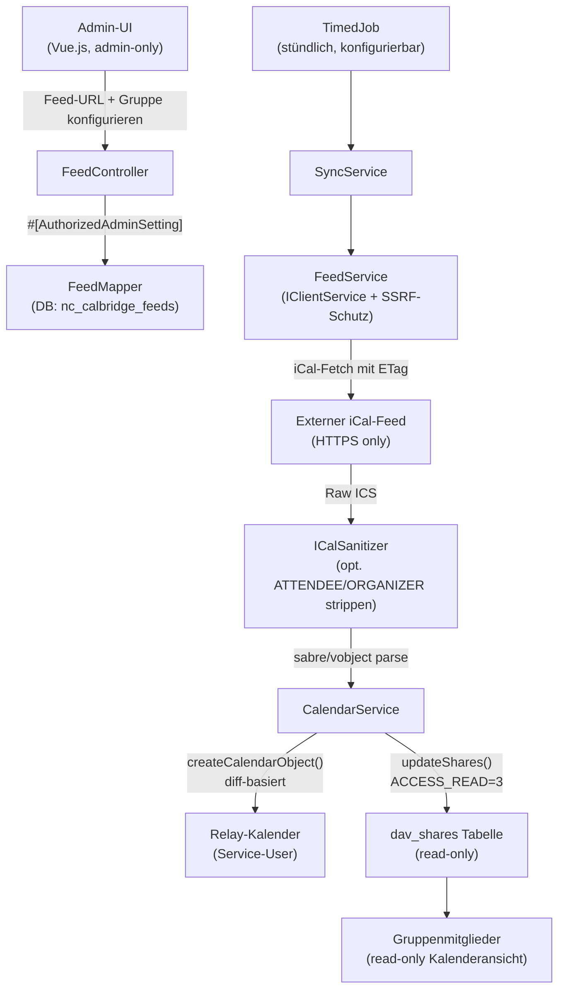

# Nextcloud "Calendar Bridge" App

## Problemstellung & Lösungsansatz

Ohne diese App müsste jedes Gruppenmitglied einen externen iCal-Link manuell einpflegen. Die App automatisiert das durch einen "Relay-Kalender": Ein dedizierter Service-User besitzt den Kalender, die App befüllt ihn via Cron aus dem externen Feed und teilt ihn **read-only** mit Nextcloud-Gruppen.

## Datenfluss




## Tech-Stack

- **Backend:** PHP 8.1+, Nextcloud OCP-Framework
- **Frontend:** Vue 3 + `@nextcloud/vue` Design System
- **iCal-Parsing:** `sabre/vobject` (bereits Nextcloud-Abhängigkeit, kein extra Composer-Paket)
- **HTTP-Client:** `OCP\Http\Client\IClientService` (built-in SSRF-Schutz + `IRemoteHostValidator`)
- **CalDAV-Schreiben:** `OCA\DAV\CalDAV\CalDavBackend` (interner DI-Service)
- **Verschlüsselung:** `OCP\IAppConfig` mit `sensitive: true` (NC 29+) für Feed-Credentials
- **Scaffolding:** [Nextcloud App Store Generator](https://apps.nextcloud.com/developer/apps/generate)

## Verzeichnisstruktur

```
calendarbridge/
├── appinfo/
│   ├── info.xml              # App-Metadaten, Background-Job-Registrierung
│   └── routes.php            # REST-API-Routen (admin-only)
├── lib/
│   ├── AppInfo/
│   │   └── Application.php   # DI-Container, Service-Registrierung
│   ├── Controller/
│   │   ├── PageController.php      # Haupt-UI (admin-only)
│   │   ├── FeedController.php      # REST API: CRUD + manualSync + preview
│   │   └── SettingsController.php  # REST API: globale App-Einstellungen
│   ├── Service/
│   │   ├── FeedService.php         # HTTP-Fetch + ICalSanitizer + sabre/vobject parse
│   │   ├── CalendarService.php     # Kalender erstellen, Events schreiben, Gruppen teilen
│   │   └── SyncService.php         # Orchestrierung: Feed → Kalender
│   ├── BackgroundJob/
│   │   └── SyncJob.php             # TimedJob, pro Feed-Eintrag, parallel=false
│   ├── Db/
│   │   ├── Feed.php                # Entity
│   │   └── FeedMapper.php          # OCP\DB\QueryBuilder Mapper
│   └── Migration/
│       └── Version0001Date20260411.php  # DB-Schema nc_calbridge_feeds
├── src/
│   ├── main.js
│   ├── App.vue
│   └── components/
│       ├── FeedList.vue        # Liste aller konfigurierten Feeds mit Status
│       ├── FeedForm.vue        # Formular: Feed anlegen/bearbeiten
│       └── GlobalSettings.vue  # App-weite Admin-Einstellungen
└── templates/
    └── index.php               # Vue-Mount-Punkt
```

## Kern-Implementierungen

### 1. DB-Schema (`nc_calbridge_feeds`)


| Feld                 | Typ           | Beschreibung                                |
| -------------------- | ------------- | ------------------------------------------- |
| `id`                 | INT PK        |                                             |
| `feed_url`           | VARCHAR(2048) | iCal/webcal URL                             |
| `feed_name`          | VARCHAR(255)  | Anzeigename des Relay-Kalenders             |
| `calendar_color`     | VARCHAR(9)    | Hex-Farbe                                   |
| `calendar_id`        | INT           | FK → Nextcloud `calendars.id`               |
| `service_user`       | VARCHAR(64)   | NC-Username des Kalenderbesitzers           |
| `target_groups`      | JSON          | Array von Gruppen-IDs                       |
| `sync_interval`      | INT           | Sekunden (min. 900 = 15 min)                |
| `last_synced_at`     | TIMESTAMP     |                                             |
| `last_etag`          | VARCHAR(255)  | HTTP ETag für 304-Caching                   |
| `last_status`        | TINYINT       | 0=ok, 1=error, 2=disabled                   |
| `last_error`         | TEXT          | Fehlermeldung (keine Eventdaten!)           |
| `consecutive_errors` | TINYINT       | Zähler aufeinanderfolgender Fehler          |
| `strip_attendees`    | BOOL          | ATTENDEE/ORGANIZER-Felder entfernen         |
| `http_auth_user`     | VARCHAR(255)  | Basic-Auth User (nullable)                  |
| `http_auth_pass`     | VARCHAR(512)  | Basic-Auth PW **verschlüsselt** via ICrypto |
| `verify_ssl`         | BOOL          | Default: true                               |
| `active`             | BOOL          | Feed aktiviert/deaktiviert                  |


### 2. Globale App-Einstellungen (via `IAppConfig`)

Gespeichert per `$appConfig->setValueString('calendarbridge', ...)`:


| Key                       | Default | Beschreibung                                   |
| ------------------------- | ------- | ---------------------------------------------- |
| `default_service_user`    | `''`    | NC-User der als Standard-Kalenderbesitzer gilt |
| `default_sync_interval`   | `3600`  | Sekunden                                       |
| `min_sync_interval`       | `900`   | Untergrenze (15 min)                           |
| `max_feed_size_mb`        | `10`    | Max. Größe des iCal-Downloads                  |
| `allow_http`              | `false` | HTTP (unsicher) erlauben — Default: nein       |
| `strip_attendees_default` | `true`  | Datensparsamkeit: Default an                   |
| `http_timeout`            | `30`    | Sekunden                                       |


### 3. `CalendarService.php` — Read-Only Sharing

Zentrale Klasse, injiziert `OCA\DAV\CalDAV\CalDavBackend`:

- `ensureCalendarExists(string $serviceUser, string $calName): int`
- `syncEvents(int $calendarId, array $vevents, bool $stripAttendees): void` — diff via UID + LAST-MODIFIED
- `shareWithGroups(int $calendarId, array $groupIds): void`:

```php
// ACCESS_READ = 3 in OCA\DAV\DAV\Sharing\Backend
$shares = array_map(fn($gid) => [
    'href'   => 'principal:principals/groups/' . $gid,
    'readOnly' => true,   // → access = 3 (ACCESS_READ)
], $groupIds);
$this->calDavBackend->updateShares($calendar, $shares, []);
```

Gruppenmitglieder erhalten damit **ausschließlich Lesezugriff** — sie können Relay-Events weder bearbeiten noch löschen.

### 4. `FeedService.php` — Sicherheit & Datensparsamkeit

```php
// SSRF-Schutz via NC-eigene Infrastruktur
$client = $this->clientService->newClient();  // IClientService
// zusätzlich: IRemoteHostValidator::isValid($host) prüfen

// webcal:// → https://
$url = preg_replace('#^webcal://#', 'https://', $feedUrl);

// HTTP-Fetch mit Größenlimit + Timeout
$response = $client->get($url, [
    'timeout'         => $this->appConfig->getValueInt('calendarbridge', 'http_timeout', 30),
    'stream'          => true,
    'headers'         => ['If-None-Match' => $feed->getLastEtag()],
    'verify'          => $feed->isVerifySsl(),
    'allow_redirects' => ['max' => 3],
]);

// Größe prüfen
if (strlen($body) > $maxBytes) throw new FeedTooLargeException();

// Optional: ATTENDEE + ORGANIZER aus VEVENT entfernen (Datensparsamkeit)
if ($feed->isStripAttendees()) {
    foreach ($vcalendar->VEVENT as $event) {
        unset($event->ATTENDEE, $event->ORGANIZER);
    }
}
```

### 5. `SyncJob.php`

```php
class SyncJob extends TimedJob {
    public function __construct(ITimeFactory $time, SyncService $syncService) {
        parent::__construct($time);
        $this->setInterval(3600);
        $this->setAllowParallelRuns(false);
        $this->setTimeSensitivity(IJob::TIME_INSENSITIVE);
    }
    protected function run($argument): void {
        $this->syncService->syncFeed((int)$argument['feedId']);
        // Kein Log von Event-Inhalten – nur Timestamp + Status
    }
}
```

### 6. Test-Preview & Manueller Sync (in `FeedController.php`)

**"Verbindung testen"** — Dry Run vor dem Speichern:

```php
// POST /api/feeds/preview
#[AuthorizedAdminSetting(settings: AdminSettings::class)]
#[UserRateLimit(limit: 5, period: 60)]  // 5 Requests/min pro Admin
public function preview(string $url): JSONResponse {
    // SSRF-Check, HTTP-Fetch, sabre/vobject parse
    // Gibt zurück: eventCount, dateRange, calendarName
    // Schreibt NICHTS in CalDAV
}
```

**"Jetzt synchronisieren"** — Manueller Sync für bestehenden Feed:

```php
// POST /api/feeds/{id}/sync
#[AuthorizedAdminSetting(settings: AdminSettings::class)]
#[UserRateLimit(limit: 3, period: 300)]  // 3 manuelle Syncs/5min pro Admin (alle Feeds)
public function manualSync(int $id): JSONResponse {
    $feed = $this->feedMapper->find($id);
    // Per-Feed-Cooldown: 5 min zwischen zwei manuellen Syncs für denselben Feed
    if ($feed->getLastManualSyncAt() > time() - 300) {
        $remaining = 300 - (time() - $feed->getLastManualSyncAt());
        return new JSONResponse(['error' => "Nächster Sync in {$remaining}s"], 429);
    }
    $result = $this->syncService->syncFeed($id);
    // Gibt zurück: added, updated, deleted, durationMs
    return new JSONResponse($result);
}
```

DB-Feld `last_manual_sync_at` (TIMESTAMP) in `nc_calbridge_feeds` ergänzen.

### 6. Frontend (`FeedForm.vue`)

- `NcTextField` für Feed-URL mit Live-Validierung (SSRF-safe Preview via eigenen Backend-Endpoint)
- `NcSelect` (Multiselect) für Zielgruppen — Liste via OCS `/cloud/groups`
- `NcPasswordField` für optionale Basic-Auth Credentials
- `NcCheckboxRadioSwitch` für `strip_attendees`, `verify_ssl`, `active`
- `NcTextField` für Sync-Intervall (min. 15 min; UI bietet Presets: 15min / 30min / 1h / 2h / 6h / 12h / 24h)
- Kalenderfarbe via `NcColorPicker`
- Warnung im UI wenn dieselbe Feed-URL bereits in einem anderen Feed-Eintrag vorkommt (cross-user)

## Duplikate & Portabilität

### Duplikat-Szenarien

- **Gleiche URL, gleicher Service-User**: Verhindert durch Unique-Index `(service_user, feed_url)` in der DB. Der zweite Eintrag wird abgelehnt.
- **Gleiche URL, verschiedene Service-User**: Technisch erlaubt (zwei unabhängige Relay-Kalender). Sinnvoll wenn verschiedene Gruppen unterschiedliche Sharing-Setups brauchen. Die App zeigt im UI eine Warnung: "Diese URL wird bereits in einem anderen Feed verwendet."
- **Gleiche URL, mehrere Zielgruppen beim selben Feed**: Das ist der Normalfall — ein Feed, `target_groups = [gruppe-a, gruppe-b]`. Kein Problem, ist direkt unterstützt.
- **Unterschiedliche URLs, inhaltlich gleich**: Nicht erkennbar, kein Handling nötig.

### Portabilität / Übertragbarkeit

Für **v1 nicht implementiert** — zu komplex, da Kalender am Service-User hängen. Dokumentierte manuelle Migration:

1. Neuen Feed mit neuem Service-User anlegen (App re-synct Events automatisch aus der Quelle)
2. Alten Feed deaktivieren → Relay-Kalender wird gelöscht
3. Keine Datenmigration nötig — Events kommen vom externen Feed neu

> Hinweis: Wird der Service-User-Account aus Nextcloud gelöscht, werden alle zugehörigen Relay-Kalender gelöscht. Feeds in der App-DB zeigen dann `status = error`. Admins werden per Notification informiert.

## Fehlerbehandlung & Benachrichtigungen

### Strategie bei Fetch-Fehlern (z.B. geänderter iCal-Link)

```
Fetch schlägt fehl (404, Auth-Error, Content-Type falsch, Timeout)
  → consecutive_errors += 1
  → bestehende Events bleiben unverändert (kein Löschen bei Fehler!)
  → last_error = "HTTP 404: Feed not found" (kein Event-Content)

Nach 3 aufeinanderfolgenden Fehlern:
  → last_status = 1 (error)
  → NC-Notification an ALLE Admins via OCP\Notification\IManager
  → Feed wird NICHT automatisch deaktiviert (Admin entscheidet)

Nach 10 aufeinanderfolgenden Fehlern (konfigurierbar):
  → active = false (automatisch pausiert)
  → erneute NC-Notification

Bei nächstem erfolgreichen Sync:
  → consecutive_errors = 0, last_status = 0
```

### Admin-Benachrichtigung

```php
// Notification an alle Admins (Gruppe "admin")
$adminGroup = $this->groupManager->get('admin');
foreach ($adminGroup->getUsers() as $admin) {
    $notification = $this->notificationManager->createNotification();
    $notification
        ->setApp('calendarbridge')
        ->setUser($admin->getUID())
        ->setObject('feed', (string)$feed->getId())
        ->setSubject('feed_error', [
            'feedName' => $feed->getFeedName(),
            'error'    => $feed->getLastError(),  // nur technischer Text, keine Eventdaten
        ]);
    $this->notificationManager->notify($notification);
}
```

### UI-Feedback

- Feed-Karten in `FeedList.vue` zeigen Status-Badge (grün/gelb/rot)
- Bei Fehler: Fehlermeldung + Zeitstempel + "Jetzt erneut versuchen"-Button
- NC-Benachrichtigungs-Glocke zeigt Hinweis für alle Admins

## Security & Privacy by Design

### Zugriffskontrolle

- Alle Controller-Methoden mit `#[AuthorizedAdminSetting(settings: AdminSettings::class)]`
- Keine Benutzer-UI — nur Admin-Panel in Nextcloud-Einstellungen
- Service-User sollte **kein Login** haben (NC-intern via `IUserManager`, `setEnabled(false)` oder dedizierter System-Account)

### SSRF-Schutz (Server-Side Request Forgery)

- Pflicht: `OCP\Http\Client\IClientService` — beinhaltet NC-eigene IP-Filterung
- Zusätzlich: `OCP\Security\IRemoteHostValidator::isValid($host)` vor dem Request prüfen
- `allow_http = false` per Default — nur HTTPS + webcal (→ HTTPS) erlaubt
- Redirect-Limit: max. 3 Hops
- Keine Anfragen an `localhost`, `127.0.0.1`, RFC-1918-Ranges (durch IClientService abgedeckt)

### Credential-Sicherheit

- Basic-Auth-Passwörter werden **nie im Klartext gespeichert**
- Verschlüsselung via `OCP\Security\ICrypto::encrypt()` bevor sie in die DB geschrieben werden
- Globale Einstellungen via `IAppConfig::setValueString(..., sensitive: true)` (NC 29+)
- Passwörter werden in API-Responses **nie zurückgegeben** (nur Platzhalter `••••••`)

### Datensparsamkeit (Privacy by Design / DSGVO)

- `strip_attendees = true` per Default: ATTENDEE- und ORGANIZER-Felder (E-Mail-Adressen) werden **vor** dem Speichern entfernt
- Admin kann das pro Feed deaktivieren (z.B. wenn intern bekannte Organisatoren gewünscht)
- Keine Analyse oder Verarbeitung von Event-Inhalten außer zur Synchronisation
- `last_error` speichert nur technische Fehlercodes/-texte, **keine Event-Daten**
- Nextcloud-eigene Aktivitäts-/Audit-Logs für Konfigurationsänderungen (via `OCP\Activity\IManager`)

### Datenlöschung

- Feed löschen → App löscht sofort den Relay-Kalender (inkl. aller Events) via `CalDavBackend::deleteCalendar()`
- App deinstallieren → Migration `down()` löscht alle App-Kalender und die `nc_calbridge_feeds`-Tabelle
- Kein Daten-Residuum nach Feed-Löschung

### Logging-Strategie

- Geloggt (via `OCP\ILogger`): Feed-ID, Timestamp, HTTP-Statuscode, Anzahl geänderter Events
- Nicht geloggt: Event-Titel, Beschreibungen, Teilnehmerdaten, Feed-URLs mit Auth-Credentials
- Log-Level DEBUG nur in Entwicklung; Production nutzt INFO/WARNING/ERROR

### DSGVO-Checkliste

- Keine Verarbeitung personenbezogener Daten über das notwendige Maß hinaus (`strip_attendees`)
- Alle Daten bleiben auf der NC-Instanz (kein Drittanbieter)
- Konfigurierbar welche Daten übernommen werden
- Transparenz: Admin-UI zeigt klar an, welche Feeds aktiv sind und welche Gruppen Zugriff haben
- Löschkonzept vorhanden (s.o.)
- Basic-Auth-Credentials verschlüsselt at rest

## Nächste Schritte (Reihenfolge)

1. Scaffolding via App Store Generator (App-ID: `calendarbridge`)
2. DB-Migration + Entity/Mapper
3. `CalendarService` + `FeedService` (Backend-Core inkl. SSRF-Schutz + Sanitizer)
4. `SyncJob` + `SyncService`
5. REST-Controller + Routen (admin-only)
6. Vue.js Frontend (Admin-Settings-UI + GlobalSettings)
7. Dev-Environment-Setup (Docker + Nextcloud-Dev-Container)
8. Manuelle Tests + App-Store-Vorbereitung (`screenshot`, `info.xml`, Datenschutzerklärung)

