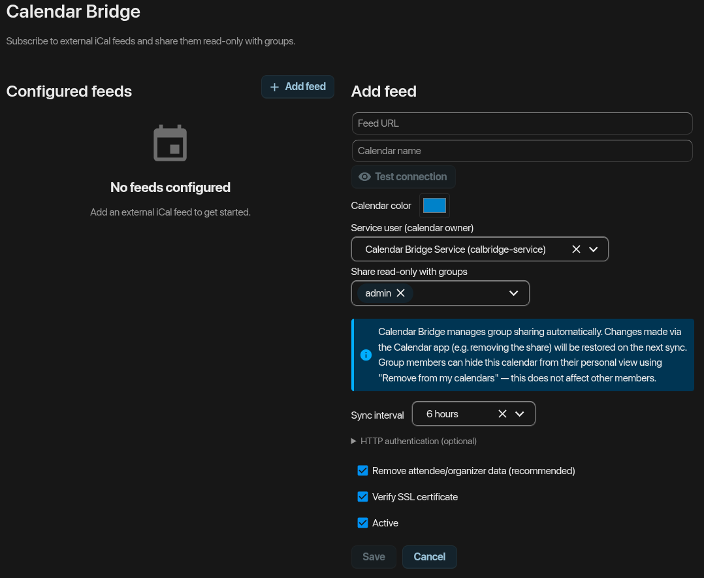

# Calendar Bridge

A Nextcloud app that allows administrators to subscribe to external iCal/WebCal feeds and mirror them internally as **relay calendars**. These calendars are automatically shared **read-only** with Nextcloud groups, eliminating the need for individual users to subscribe to the feeds themselves.

## Project Status

Calendar Bridge is functionally complete and under active maintenance. The `0.x`
version number reflects limited exposure to different setups so far, not an
unfinished feature set.
It is **not yet available** in the official Nextcloud App Store.
Publishing to the official Nextcloud App Store is the target.

Contributions, optimizations, and feedback are highly welcome!

## Features

- **Centralized Management:** Subscribe to external iCal/WebCal feeds once and mirror them internally.
- **Automated Sync:** Background synchronization via Nextcloud cron.
- **Group Sharing:** Automatic read-only sharing with any Nextcloud groups.
- **Efficient:** Diff-based sync and ETag/Last-Modified support prevent redundant downloads.
- **Privacy:** Optional stripping of `ATTENDEE`/`ORGANIZER` email addresses before storage.
- **Security:** Support for HTTP Basic Auth and strict SSRF protections.

## Requirements

- Nextcloud 30 – 34
- PHP 8.2+ (8.5 recommended on Nextcloud 34)
- Reliable Nextcloud cron (systemd timer or crontab recommended)
- DAV app enabled

## Installation

### Nextcloud App Store

Once published: **Apps → Organization → Calendar Bridge → Enable**.

### Manual Installation

```bash
cd /var/www/nextcloud/apps
git clone https://github.com/joe7ean/calendarbridge.git calendarbridge
cd calendarbridge
composer install --no-dev
npm ci && npm run build
```

Then enable the app in the Nextcloud interface.

## Setup

### 1. Create a Service User

The app requires a dedicated Nextcloud user to own the relay calendars. This account should not be used for regular logins.

```bash
# Create the user
php occ user:add --display-name="Calendar Bridge Service" calbridge-service

# Secure the login (set a random password)
RNDPW=$(openssl rand -base64 48)
OC_PASS="$RNDPW" php occ user:resetpassword --password-from-env calbridge-service
unset RNDPW OC_PASS
```

### 2. Configure the App

Go to **Settings → Administration → Calendar Bridge**:

- **Default service user:** Enter the newly created user (e.g., `calbridge-service`).
- Adjust other global settings like the sync interval as needed.

### 3. Add a Feed

In the admin panel under **Add feed**:

- Enter the URL (`https://...` or `webcal://...`).
- Set the name, color, and target groups.


### Screenshot

The Calendar Bridge Admin Panel UI:



## Development

Requirements: Node.js 20+, PHP 8.2+, Composer.

```bash
git clone https://github.com/joe7ean/calendarbridge.git
cd calendarbridge
composer install
npm ci
npm run build
```

## License

[AGPL-3.0-only](LICENSE)
